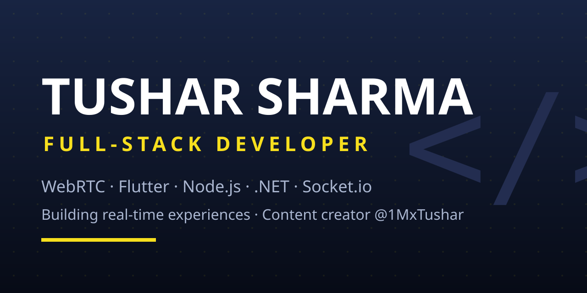

<h1 align="center">Hi there, I'm Tushar Sharma 👋</h1>

  

  
  

## 🚀 About Me

- ⚡ Full-Stack Developer crafting **real-time experiences** with WebRTC & LiveKit
- 🎥 Creating coding content as **@1MxTushar** — tutorials, tech vlogs & AI tools
- 💬 Ask me about: WebRTC, Flutter, Node.js, Socket.io, .NET
- 🌱 Always learning, always shipping

## 🛠️ Tech Stack

### Languages

### Mobile

### Backend

### Real-Time & Streaming

### Databases

### Tools & Platforms

